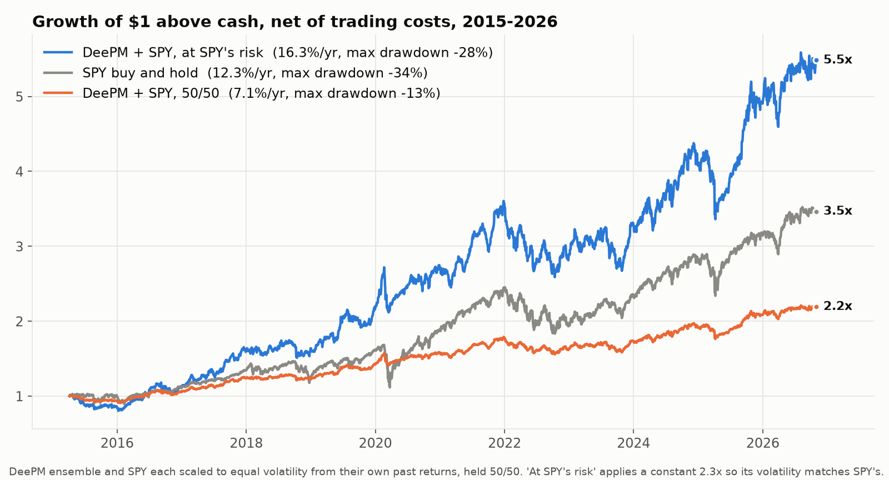
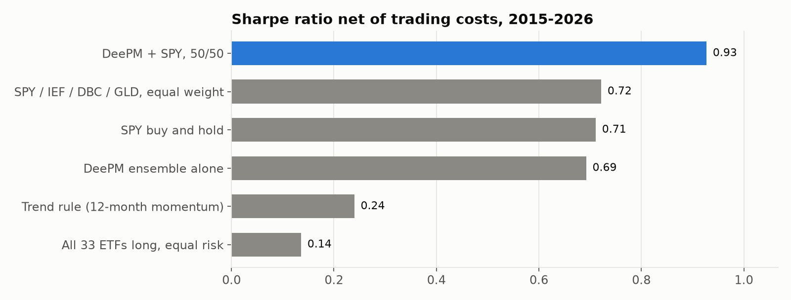
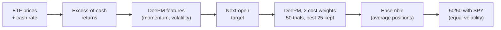

# deep-momentum-etf

**DeePM, a 2026 deep-learning portfolio manager, adapted from futures to ETFs anyone can trade. Held next to the S&P 500, it lifts the Sharpe ratio from 0.70 to 0.93, net of real trading costs.**

[](https://github.com/randyy179/deep-momentum-etf/actions/workflows/tests.yml)


[](https://arxiv.org/abs/2601.05975)



At the same risk as SPY, DeePM + SPY earned **16.3% a year above cash against SPY's 12.3%**, with a shallower worst drawdown (−28% vs −34%). The two legs are almost uncorrelated (0.10), so each cushions the other.

## Results, 2015–2026

Everything below is net of trading costs, with orders placed after the close and filled at the next day's open.

| Strategy | Sharpe | Return above cash | Volatility | Max drawdown |
|---|---|---|---|---|
| **DeePM + SPY, 50/50** | **0.93** | 7.1% | 7.7% | **−13%** |
| **DeePM + SPY, at SPY's risk** | **0.93** | **16.3%** | 17.6% | −28% |
| SPY buy and hold | 0.70 | 12.3% | 17.6% | −34% |
| DeePM ensemble alone | 0.69 | | 10%¹ | −14% |
| Trend rule (12-month momentum) | 0.24 | | 10%¹ | −29% |

¹ Scaled to 10% volatility by the backtester. Combinations start in April 2015, after a 63-day volatility warm-up.



**On its own, DeePM beats the classic trend-following rule by almost 3×** (0.69 vs 0.24), using the same 33 ETFs, the same costs and the same execution. Its value in a portfolio comes from being different from the stock market.

## What this project adds to the paper

The [DeePM paper](https://arxiv.org/abs/2601.05975) trades 50 futures contracts. Futures need a broker account with margin, roll contracts every quarter and come in large sizes. ETFs trade like stocks. Moving the model across took more than changing the tickers:

| Difference | What this repository does |
|---|---|
| ETF returns include interest on the fund's cash; futures returns don't | Subtracts the daily Fed funds rate, so the model learns from **excess returns** just as in the paper |
| A signal computed at the close cannot trade at that close | Trains and backtests on **next-open execution**: decide after the close, fill at the next open |
| Every ETF has its own bid-ask spread | Charges each of the 33 ETFs its **issuer-published median spread**, in training and in the backtest |
| The original code targets CUDA and runs its hyperparameter search through a Weights & Biases server | Runs on **Apple Silicon, CPU or one GPU**, with an offline hyperparameter search that resumes after interruption and shards across processes |
| A deep model needs a fair yardstick | Ships **trend-following, buy-and-hold, linear and MLP baselines** evaluated under identical rules |
| Research code is a set of scripts | **One command line**, `dmetf`, from raw prices to report |

The universe covers four asset classes: US and international equities (11), government and credit bonds (8), commodities (7) and currencies (7). See [configs/tcost/etf.csv](configs/tcost/etf.csv).

## Quick start

```bash
uv venv --python 3.12 .venv && uv pip install --python .venv/bin/python -e .
export WANDB_MODE=offline   # no experiment-tracking server needed

dmetf data --prices data/prices.parquet --cash-rate data/DFF.csv   # your data, see docs/DATA.md
dmetf train                                                        # GPU recommended; --shards N runs N processes per GPU
dmetf backtest                                                     # DeePM, ensemble and reference strategies
dmetf report                                                       # reports/summary.csv and reports/equity.png
```

Bring daily prices from any vendor ([format](docs/DATA.md)) and the [DFF](https://fred.stlouisfed.org/series/DFF) series from FRED. Training runs 50 random-search trials per test window for each of two cost weights: a few hours on a single RTX 3090, considerably longer on a laptop. `DEEPM_DEVICE=cpu|mps|cuda:0` picks the device. `python scripts/make_readme_figures.py` redraws the figures above.

## How it works



- **Model.** The paper's "independent" DeePM variant (its Table 2): the temporal transformer over each asset's recent history and the robust worst-window Sharpe objective net of costs, without the cross-asset attention and macro-graph layers. Test windows start in 2015 and 2020, each trained on all data from 1998 up to its start; nothing from a test window is seen in training.
- **Cost-aware training.** Two cost weights (γ = 0.5 and 2) trade off return against turnover. Averaging their positions trades less than the more active model while keeping most of its return.
- **Combination.** The ensemble and SPY are each scaled to the same volatility using only their own past returns, then held 50/50.

## Engineering notes

- **Verified rather than assumed.** Every stage of this repository was checked against the original research runs: the built feature file is identical value for value (175,694 rows × 49 columns), and backtests reproduce every Sharpe ratio above.
- **Unit tests** cover the excess-return and next-open calculations and the benchmark weights; they run on every push.
- **Clean history.** The first three commits are the official code, unchanged. Each later pull request is one self-contained step (portability, data layer, baselines, ensemble, command line) with its verification written in the description.

## Built with Claude Code

This project was built by one person working with [Claude Code](https://claude.com/claude-code), Anthropic's coding agent, and the commits say so. The division of labour:

- **Me:** the research question, which evaluation rules to hold the model to (excess returns, real spreads, next-open fills, fair baselines), every judgement about what to keep and what to drop, and review of each result.
- **Claude Code:** most of the code, running the experiments, cross-checking each number against the baselines, and the documentation.

## Built on

This repository starts from the official DeePM code by Kieran Wood, <https://github.com/kieranjwood/deepm>, released under the MIT license; its original README is kept at [docs/UPSTREAM_README.md](docs/UPSTREAM_README.md). If you use the model, please cite the paper:

```bibtex
@article{wood2026deepm,
  title={DeePM: Regime-Robust Deep Learning for Systematic Macro Portfolio Management},
  author={Wood, Kieran and Roberts, Stephen J and Zohren, Stefan},
  journal={arXiv preprint arXiv:2601.05975},
  year={2026}
}
```

## Disclaimer

Backtested results on historical data, not a guarantee of future returns and not investment advice. Spreads are a recent snapshot; trading costs were higher in earlier years.

## License

MIT, see [LICENSE](LICENSE). The original copyright notice is retained.
